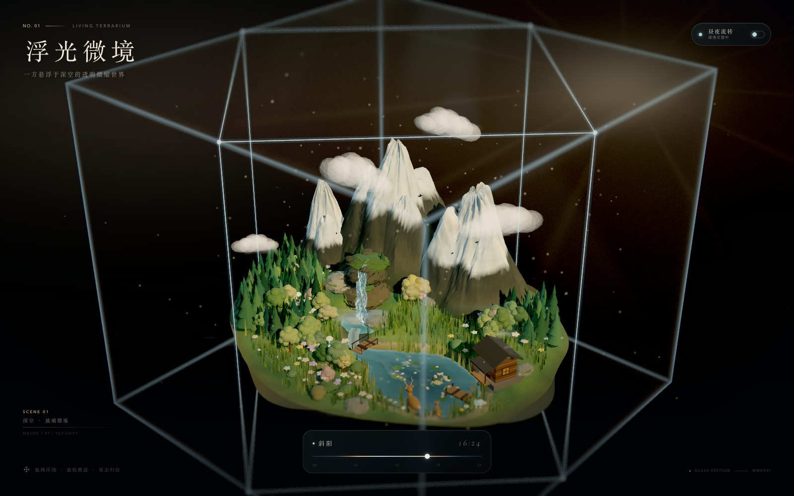

# 浮光微境 · A Floating Terrarium

> 一方悬浮在深空中的透明玻璃微缩世界。雪山融水落入小湖，瀑布穿过苔石，
> 鹿在花甸上停留，云朵与尘埃在昼夜的光里缓慢移动。

这是一个无需安装依赖、也不需要联网加载外部素材的 Three.js 交互场景。
所有几何、粒子、水面、云朵、雪山与玻璃都来自程序化生成；Three.js r170
和展示字体已经随项目本地打包。



## 运行

```bash
cd floating-terrarium
python3 server.py 4179
```

打开 <http://127.0.0.1:4179>。

建议使用支持 WebGL 2 的现代浏览器，并开启硬件加速。项目通过本地
`<script type="module">` 加载，因此建议用上面的本地服务器访问，而不要直接
双击 `index.html`（浏览器可能会拦截模块加载）。

## 交互

| 操作 | 效果 |
| --- | --- |
| 拖拽画面 | 在等距视角附近环绕观察微缩世界 |
| 滚轮 / 双指捏合 | 推近 / 拉远镜头 |
| 双击画面 或 `R` | 回到默认镜头 |
| 右上角「昼夜流转」 | 暂停 / 继续缓慢的昼夜循环 |
| 底部时间滑杆 | 手动把时间拨到破晓、正午、斜阳、星夜等任意时刻 |
| `Space` | 暂停 / 继续昼夜流转 |
| 下方时间轴 | 显示当前时刻与当天的光线阶段 |

页面默认停在斜阳时分（约 16:19），昼夜一轮约 7 分钟。若系统开启了
“减少动态效果”，自动播放会默认暂停，仍可用滑杆或按钮手动体验。

## 场景细节

- **独立世界**：程序化悬浮岛，包含按海拔着色的草地、雪山、岩石、溪流小湖，
  岛底被上升的薄雾和深空包围。
- **玻璃立方体**：自写玻璃菲涅耳着色器、微弱的薄膜色散与缓慢流动的面内微光；
  十二条发光棱边、角部闪点，以及深空背景里的太阳光晕和体积感屏幕空间光束。
- **水系统**：湖面、蜿蜒河流、瀑布、悬崖顶部小水潭和跌落水雾使用独立 GLSL
  水面 / 瀑布着色器；水流、泡沫、反射、波光与阳光镜面高光都有动态变化。
- **生态细节**：松林、阔叶林、灌丛、芦苇、睡莲、浮花瓣、野花、蘑菇、苔石、
  木屋、码头、石桥、鹿、兔、鸭、蝴蝶、飞鸟、晚间萤火虫。
- **昼夜**：多段调色关键帧驱动太阳 / 月亮角度、环境光、轮廓光、窗户与提灯、
  萤火虫、水面颜色、玻璃色调和后期曝光；过渡平滑连续。
- **镜头与后期**：26° 左右的长焦等距镜头、指针环绕、阻尼、微距移轴景深、
  ACES 色调映射、柔和高光泛光、色差、暗角、胶片颗粒、屏幕空间太阳光束。
- **响应式与性能**：桌面 / 平板 / 手机竖屏使用不同的镜头距离与 FOV，限制设备
  像素比；场景基于实例化森林与草甸，避免重复 draw call。

## 文件结构

```text
floating-terrarium/
├── index.html
├── styles.css
├── server.py
├── README.md
├── THIRD_PARTY_NOTICES.md
├── preview-day.png
├── preview-night.png
├── preview-mobile.png
├── assets/
│   ├── favicon.svg
│   └── fonts/cormorant-italic-300.woff2
├── js/
│   ├── main.js          # 启动、镜头、UI、昼夜循环
│   ├── geography.js     # 地形高度、河流与湖泊的共享地理数据
│   ├── terrain.js       # 岛屿、程序化雪山、瀑布岩壁、苔石
│   ├── water.js         # 湖面 / 河流 / 瀑布 / 水雾
│   ├── flora.js         # 森林、草甸、花、芦苇、睡莲、蘑菇
│   ├── details.js       # 小屋、鹿、鸭、蝴蝶、鸟、云、雾、粒子、远景
│   ├── world.js         # 玻璃立方体、灯光、昼夜调色、悬浮岛组装
│   ├── postfx.js        # 泛光、移轴景深、屏幕空间太阳光、调色与颗粒
│   ├── noise.js         # 确定性噪声与随机
│   └── utils.js         # 几何合并、程序化贴图、PBR 环境贴图
└── vendor/three/three.module.js
```

## 实现说明

- 岛体、雪山和河床共享同一份 `geography.js` 高度函数；湖岸搜索、河流刻槽、
  树木和动物的落点都依赖它，所以水、岸和摆件不会彼此穿插。
- 湖水颜色、河流和瀑布分别使用独立的 GLSL 材质，但共享光照 / 时间 uniforms。
  湖岸的沙线与水面泡沫由地形和水面共同决定。
- 森林与草甸使用 `InstancedMesh`；每棵树 / 每簇草拥有独立的实例颜色，并通过
  顶点着色器获得非常轻的风动。
- 自写的后期管线包含亮部提取、分离式高斯泛光、移轴虚化、太阳体积光、ACES、
  暗角、颗粒和设备像素比处理，不依赖 Three.js 的 addon 模块。

## 兼容性

- 推荐 Chrome / Edge / Safari 16+，需要 WebGL 2 和 JavaScript。
- 如果页面显示“微境未能如约展开”，请检查浏览器的硬件加速是否开启，或换用
  支持 WebGL 2 的浏览器。
- 若 4179 端口被占用，可运行 `python3 server.py 4180`，然后访问对应地址。

## 版权与许可

界面、场景、程序化几何和 shader 为本项目创作。Three.js 与 Cormorant
Garamond 字体保留原始许可，详见 [THIRD_PARTY_NOTICES.md](./THIRD_PARTY_NOTICES.md)。
